 

 

  

 

## 🛠️ Minha caixa de ferramentas

   
   
  

## 🚀 Projetos em destaque

<table>
  <tr>
    <td width="50%"></td>
    <td width="50%"></td>
  </tr>
  <tr>
    <td width="50%"></td>
    <td width="50%"></td>
  </tr>
</table>

 

<i>"Não te gabes do dia de amanhã, porque não sabes o que o dia trará." — Provérbios 27:1</i>

